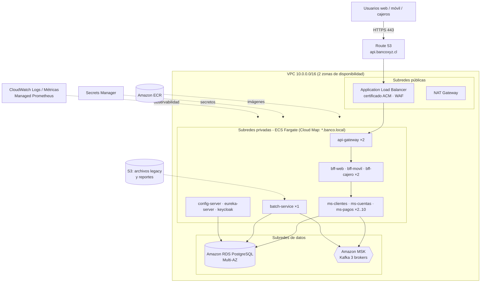

# Despliegue del sistema en la nube (AWS)

Este documento describe dos formas de desplegar la plataforma del **Banco XYZ** en Amazon Web Services:

| | Opción A: EC2 + Docker Compose | Opción B: ECS Fargate + servicios administrados |
|---|---|---|
| Uso | Demostración, QA, evaluación | Producción |
| Esfuerzo | ~30 minutos | 1 a 2 días (idealmente con IaC) |
| Infraestructura | 1 máquina virtual con todo el `docker-compose.yml` | ECR, ECS Fargate, RDS, MSK, ALB + ACM, Secrets Manager, CloudWatch |
| Escalado | Manual (`--scale`) dentro de la instancia | Automático (ECS Service Auto Scaling) en varias zonas de disponibilidad |
| Costo aproximado | ~USD 0,17/h (t3.xlarge) | Desde ~USD 400/mes |

Las imágenes son las mismas en ambas opciones: el `Dockerfile` único genera una imagen por módulo y toda la configuración se inyecta con variables de entorno.

---

## Arquitectura objetivo en AWS (Opción B)



---

## Opción A: EC2 + Docker Compose

### A.1 Crear la instancia

1. En la consola de AWS → **EC2 → Launch instance**:
   - **AMI:** Amazon Linux 2023 (x86_64).
   - **Tipo:** `t3.xlarge` (4 vCPU, 16 GB RAM). Con menos de 8 GB el stack no cabe.
   - **Key pair:** crea uno (por ejemplo `banco-xyz.pem`).
   - **Almacenamiento:** 30 GB gp3.
2. **Security Group** `banco-xyz-sg`, reglas de entrada:

   | Puerto | Origen | Uso |
   |---|---|---|
   | 22 | Tu IP (`x.x.x.x/32`) | SSH |
   | 8080 | 0.0.0.0/0 | API Gateway (HTTP/HTTPS) |
   | 8180 | 0.0.0.0/0 | Keycloak (emisión de tokens) |
   | 8761, 8090, 9411, 9090 | Tu IP | Consolas de Eureka, Kafka UI, Zipkin y Prometheus |

   > PostgreSQL (5432), Kafka (29092) y Config Server (8888) **no** se abren a Internet.
3. Asigna una **Elastic IP** a la instancia para que la IP pública no cambie.

### A.2 Instalar Docker y desplegar

```bash
ssh -i banco-xyz.pem ec2-user@<ELASTIC_IP>

# Docker + Compose v2 + git
sudo dnf update -y
sudo dnf install -y docker git
sudo systemctl enable --now docker
sudo usermod -aG docker ec2-user
sudo mkdir -p /usr/local/lib/docker/cli-plugins
sudo curl -SL https://github.com/docker/compose/releases/latest/download/docker-compose-linux-x86_64 \
     -o /usr/local/lib/docker/cli-plugins/docker-compose
sudo chmod +x /usr/local/lib/docker/cli-plugins/docker-compose
exit   # volver a entrar para aplicar el grupo docker
```

```bash
ssh -i banco-xyz.pem ec2-user@<ELASTIC_IP>
sudo git clone <url-del-repo> /opt/banco-xyz && sudo chown -R ec2-user /opt/banco-xyz
cd /opt/banco-xyz

# Secretos propios del ambiente (no usar los valores por defecto)
cp .env.example .env
nano .env        # cambiar DB_PASSWORD y KEYCLOAK_ADMIN_PASSWORD

docker compose up -d --build
docker compose ps        # esperar que todos queden "healthy"
```

### A.3 HTTPS

Elige una de estas dos alternativas:

- **Certificado propio en el gateway:**
  ```bash
  ./scripts/generar-certificados.sh          # o copiar a certs/banco-xyz.p12 un certificado real
  echo "SSL_ENABLED=true" >> .env
  docker compose up -d api-gateway
  ```
- **Recomendado:** crea un **Application Load Balancer** con un certificado de **ACM** para tu dominio (listener 443 → target group de la instancia, puerto 8080, health check `/actuator/health`). Así TLS termina en el ALB y el puerto 8080 queda abierto solo para el security group del ALB.

### A.4 Arranque automático tras un reinicio

```bash
sudo cp aws/banco-xyz.service /etc/systemd/system/
sudo systemctl daemon-reload
sudo systemctl enable --now banco-xyz
```

### A.5 Verificar

Desde tu computador:

```bash
export KEYCLOAK_URL=http://<ELASTIC_IP>:8180
export GATEWAY_URL=http://<ELASTIC_IP>:8080
./scripts/demo.sh
```

> Los servicios validan la firma y la expiración del JWT con el JWKS interno (`keycloak:8080`), así que los tokens emitidos a través de la IP pública funcionan sin cambiar la configuración.

### A.6 Escalar en la instancia

```bash
docker compose up -d --scale ms-pagos=4 --scale bff-web=2
```

---

## Opción B: producción con ECS Fargate

### B.1 Mapeo de componentes

| Componente local | Servicio AWS | Notas |
|---|---|---|
| Imágenes Docker | **Amazon ECR** | `scripts/push-ecr.sh`, con escaneo de vulnerabilidades al subir |
| Contenedores Spring | **ECS Fargate** (un *service* por módulo) | Sin servidores que administrar; modo de red `awsvpc` |
| PostgreSQL | **Amazon RDS for PostgreSQL 16**, Multi-AZ | Una instancia con 4 bases (`clientes_db`, `cuentas_db`, `pagos_db`, `batch_db`) + `keycloak_db`; respaldos automáticos |
| Kafka | **Amazon MSK** (3 brokers, 3 AZ) | Replication factor 3; cambiar `.replicas(1)` a `.replicas(3)` en los `NewTopic` |
| Keycloak | ECS Fargate (2 tareas) + RDS | Alternativa administrada: Amazon Cognito (requiere adaptar los roles) |
| Config Server / Eureka | ECS Fargate, servicios internos | Descubribles vía **AWS Cloud Map** (`config-server.banco.local`); Eureka registra la IP de cada tarea |
| Balanceo externo + TLS | **ALB** + **ACM** + **AWS WAF** | Listener 443 → target group del `api-gateway`; HTTP 80 redirige a 443 |
| Secretos | **AWS Secrets Manager** | Contraseña de BD, *client secrets* de `ms-pagos` y `ms-cuentas`, admin de Keycloak |
| Logs | **CloudWatch Logs** (driver `awslogs`) | Grupo `/ecs/banco-xyz`; el `traceId` permite correlacionar |
| Métricas / trazas | **Amazon Managed Prometheus** + Grafana, **AWS X-Ray** o Zipkin | `/actuator/prometheus` en cada tarea |
| Archivos legacy y reportes | **Amazon S3** | Montar con un *sidecar* o sincronizar a `BATCH_INPUT_DIR` / `BATCH_OUTPUT_DIR` |
| Planificación batch | **EventBridge Scheduler** → ECS RunTask, o `BATCH_SCHEDULER=true` | Una sola tarea de batch |

### B.2 Red (VPC)

1. **VPC** `10.0.0.0/16` con 2 zonas de disponibilidad:
   - 2 subredes **públicas** (ALB y NAT Gateway).
   - 2 subredes **privadas de aplicación** (tareas ECS).
   - 2 subredes **privadas de datos** (RDS y MSK).
2. **Security Groups**:

   | SG | Entrada permitida |
   |---|---|
   | `sg-alb` | 443 desde 0.0.0.0/0 |
   | `sg-gateway` | 8080 desde `sg-alb` |
   | `sg-apps` | 8081-8093, 8761, 8888, 8080 (Keycloak) desde `sg-gateway` y desde `sg-apps` |
   | `sg-rds` | 5432 desde `sg-apps` |
   | `sg-msk` | 9092/9094 desde `sg-apps` |

### B.3 Publicar las imágenes en ECR

```bash
aws configure                                   # credenciales con permisos de ECR
AWS_REGION=us-east-1 ./scripts/push-ecr.sh 1.0.0
```

### B.4 Datos y mensajería

```bash
# RDS PostgreSQL (simplificado; en producción usar subnet group privado y Multi-AZ)
aws rds create-db-instance --db-instance-identifier banco-xyz-db \
  --engine postgres --engine-version 16 --db-instance-class db.t4g.medium \
  --allocated-storage 50 --master-username banco --manage-master-user-password \
  --multi-az --no-publicly-accessible --vpc-security-group-ids <sg-rds> \
  --db-subnet-group-name banco-data-subnets --backup-retention-period 7
```

- Crea las bases ejecutando `docker/postgres/init.sql` (más `CREATE DATABASE keycloak_db;`) desde una tarea o un bastión.
- **MSK:** crea un cluster *provisioned* de 3 brokers (`kafka.t3.small` en QA) en las subredes de datos, con cifrado TLS en tránsito. Usa los *bootstrap brokers* como `KAFKA_BOOTSTRAP`.

### B.5 Secretos

```bash
aws secretsmanager create-secret --name banco/db-password --secret-string '<password>'
aws secretsmanager create-secret --name banco/ms-pagos-client-secret --secret-string '<secret>'
aws secretsmanager create-secret --name banco/ms-cuentas-client-secret --secret-string '<secret>'
```

Actualiza los mismos *client secrets* en Keycloak (clientes `ms-pagos` y `ms-cuentas`). El rol de ejecución de ECS (`ecsTaskExecutionRole`) debe tener `secretsmanager:GetSecretValue` sobre esos ARN.

### B.6 Cluster, task definitions y servicios

```bash
aws ecs create-cluster --cluster-name banco-xyz \
  --service-connect-defaults namespace=banco.local

# Una task definition por módulo (ejemplo completo en aws/ecs-task-ms-pagos.json)
aws ecs register-task-definition --cli-input-json file://aws/ecs-task-ms-pagos.json

aws ecs create-service --cluster banco-xyz --service-name ms-pagos \
  --task-definition banco-ms-pagos --desired-count 2 --launch-type FARGATE \
  --network-configuration "awsvpcConfiguration={subnets=[<priv-a>,<priv-b>],securityGroups=[<sg-apps>],assignPublicIp=DISABLED}" \
  --deployment-configuration "minimumHealthyPercent=100,maximumPercent=200,deploymentCircuitBreaker={enable=true,rollback=true}" \
  --service-registries "registryArn=<cloud-map-service-arn>"
```

Orden de creación de los servicios: `keycloak` → `config-server` → `eureka-server` → `ms-clientes`, `ms-cuentas`, `ms-pagos` → `bff-*` → `batch-service` → `api-gateway` (asociado al target group del ALB).

| Servicio | CPU / memoria | Tareas (mín–máx) |
|---|---|---|
| config-server, eureka-server | 0,25 vCPU / 512 MB | 2 |
| api-gateway | 0,5 vCPU / 1 GB | 2–6 |
| bff-web, bff-movil, bff-cajero | 0,5 vCPU / 1 GB | 2–6 |
| ms-clientes, ms-cuentas, ms-pagos | 0,5 vCPU / 1 GB | 2–10 |
| batch-service | 1 vCPU / 2 GB | 1 |

**Variables de entorno por servicio** (las mismas que en `docker-compose.yml`): `CONFIG_SERVER_URL`, `EUREKA_URL`, `DB_HOST`, `DB_USER`, `DB_PASSWORD` (secreto), `KAFKA_BOOTSTRAP`, `KEYCLOAK_JWKS_URI`, `KEYCLOAK_TOKEN_URI`, `ZIPKIN_URL`, `MS_PAGOS_SECRET` / `MS_CUENTAS_SECRET` (secretos) y `JAVA_OPTS=-XX:MaxRAMPercentage=75`.

### B.7 Load balancer y HTTPS

1. Solicita un certificado en **ACM** para `api.bancoxyz.cl` (validación por DNS).
2. Crea el **ALB** en las subredes públicas con:
   - Listener **443 (HTTPS)** con el certificado de ACM y la política `ELBSecurityPolicy-TLS13-1-2-2021-06`.
   - Listener 80 que redirige a 443.
   - Target group `tg-gateway` de tipo IP, puerto 8080, health check `/actuator/health`.
3. Asocia **AWS WAF** con las reglas administradas (Core rule set, SQLi, IP reputation).
4. En **Route 53**, crea un registro A (alias) `api.bancoxyz.cl` apuntando al ALB.
5. Expón Keycloak solo para el login y la emisión de tokens: `auth.bancoxyz.cl` → regla del ALB hacia el target group de Keycloak, con `KC_HOSTNAME=https://auth.bancoxyz.cl`. Con un hostname fijo se puede activar la validación del `issuer` en `JwtDecoderFactory`.

### B.8 Escalado automático (horizontal)

```bash
aws application-autoscaling register-scalable-target --service-namespace ecs \
  --resource-id service/banco-xyz/ms-pagos --scalable-dimension ecs:service:DesiredCount \
  --min-capacity 2 --max-capacity 10

aws application-autoscaling put-scaling-policy --service-namespace ecs \
  --resource-id service/banco-xyz/ms-pagos --scalable-dimension ecs:service:DesiredCount \
  --policy-name cpu60 --policy-type TargetTrackingScaling \
  --target-tracking-scaling-policy-configuration \
  '{"TargetValue":60,"PredefinedMetricSpecification":{"PredefinedMetricType":"ECSServiceAverageCPUUtilization"},"ScaleInCooldown":120,"ScaleOutCooldown":60}'
```

Por qué escala sin cambios de código:

- Las nuevas tareas se registran solas en Eureka y el gateway y los Feign las balancean.
- Los consumidores Kafka del mismo grupo se reparten las particiones.
- Solo una réplica reprocesa cada pago pendiente (*claim* atómico en BD).
- El apagado *graceful* evita cortar peticiones al desescalar.

### B.9 Procesos batch en AWS

- Los CSV del legacy se dejan en `s3://banco-xyz-legacy/data/semana_N/` y se sincronizan al volumen de la tarea (o con un *init container*). Luego se apunta `BATCH_INPUT_DIR=file:/data`.
- La programación se hace con **EventBridge Scheduler** (expresiones cron equivalentes a las del legacy) invocando `POST /api/batch/jobs/{job}` con un token de servicio. Alternativa: `BATCH_SCHEDULER=true` en una única tarea.
- Los reportes (`/app/output`) se copian a `s3://banco-xyz-reportes/` para auditoría, con *lifecycle* a Glacier.

### B.10 Monitoreo y operación

| Qué | Dónde |
|---|---|
| Logs de todos los servicios | CloudWatch Logs `/ecs/banco-xyz`; búsqueda por `traceId` con Logs Insights |
| Alarmas | CloudWatch: 5XX del ALB > 1 %, CPU > 80 %, tareas `RUNNING` < mínimo, `resilience4j_circuitbreaker_state{state="open"}` |
| Métricas de negocio y técnicas | Amazon Managed Prometheus + Amazon Managed Grafana |
| Trazas distribuidas | Zipkin en ECS o AWS X-Ray (OpenTelemetry) |
| Despliegues sin corte | Rolling update de ECS con *deployment circuit breaker* y rollback automático |

### B.11 Pipeline CI/CD (sugerido)

```
GitHub push → GitHub Actions / CodePipeline
   ├─ mvn verify (tests)
   ├─ docker build + push a ECR (tag = commit SHA)
   └─ aws ecs update-service --force-new-deployment (por módulo modificado)
```

---

## Checklist de seguridad para producción

- [ ] Cambiar **todas** las contraseñas y *client secrets* por defecto (`banco123`, `admin`, `ms-pagos-secret`, ...).
- [ ] Deshabilitar `directAccessGrantsEnabled` (password grant) en `web-app`, `movil-app` y `cajero-app`; usar Authorization Code + PKCE.
- [ ] Ejecutar Keycloak en modo `start` (no `start-dev`) con su base de datos en RDS.
- [ ] Usar `sslRequired: external` en el realm y TLS de punta a punta.
- [ ] mTLS para los cajeros automáticos (certificado por terminal) además de `X-Cajero-Id`.
- [ ] No exponer `/actuator/**` en el ALB (solo red interna).
- [ ] Cifrado en reposo en RDS, MSK y S3 (KMS).
- [ ] Reemplazar `ddl-auto: update` por migraciones Flyway.

## Limpieza (para no generar costos)

- **Opción A:** termina la instancia EC2 y libera la Elastic IP.
- **Opción B:** elimina los servicios y el cluster de ECS, el ALB, MSK, RDS (con *snapshot* final si corresponde), los repositorios ECR, el NAT Gateway y los secretos.
