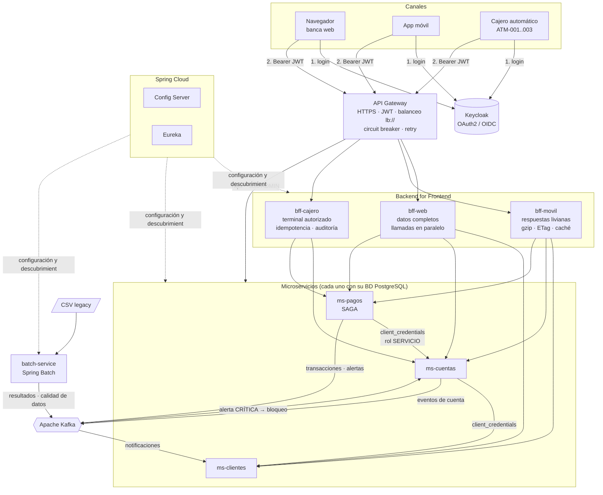

# Banco XYZ — Modernización Backend: Spring Cloud + Spring Batch

**Evaluación Final Transversal – Desarrollo Backend III (PBY2203)**

Migración del sistema legacy del Banco XYZ (COBOL + scripts Shell en mainframe) a una arquitectura de microservicios en la nube, compuesta por:

- **Procesos batch** reescritos en **Spring Batch**: 3 jobs con reintentos, omisión de registros inválidos, procesamiento multihilo y particionado, y reejecución automática.
- **Backend for Frontend (BFF)**: un backend por canal (web, móvil y cajeros automáticos), cada uno con su propia autenticación y su propio formato de respuesta.
- **Microservicios resilientes** con **Spring Cloud**: Config Server, Eureka, Gateway con balanceo de carga, OAuth2/Keycloak, Resilience4j, Apache Kafka y Docker Compose.

> 📄 Documentos de la entrega:
> - [`instrucciones.md`](instrucciones.md): cómo ejecutar y probar cada componente.
> - [`despliegue.md`](despliegue.md): cómo desplegar el sistema en AWS.

---

## 1. Arquitectura



### Módulos

| Módulo | Puerto | Responsabilidad |
|---|---|---|
| `common-lib` | — | Librería compartida: eventos Kafka, validación JWT por canal, token relay, manejo de errores |
| `config-server` | 8888 | Configuración centralizada (`config-repo/*.yml`) |
| `eureka-server` | 8761 | Registro y descubrimiento dinámico de servicios |
| `api-gateway` | 8080 | Único punto de entrada: enrutamiento, balanceo (`lb://`), seguridad perimetral, HTTPS, circuit breaker |
| `ms-clientes` | 8083 | Datos personales y perfiles; consumidor Kafka que genera notificaciones |
| `ms-cuentas` | 8081 | Apertura, cierre, bloqueo y mantenimiento de cuentas; cargos y abonos atómicos e idempotentes |
| `ms-pagos` | 8082 | Pagos, transferencias, depósitos y retiros (SAGA con compensación); detección de fraude; productor Kafka |
| `bff-web` | 8091 | Canal web: vistas completas y agregadas |
| `bff-movil` | 8092 | Canal móvil: payload mínimo, gzip, ETag, caché de último saldo |
| `bff-cajero` | 8093 | Canal cajeros: terminal autorizado, Idempotency-Key obligatorio, límites de monto, auditoría |
| `batch-service` | 8084 | 3 jobs Spring Batch que reemplazan los procesos COBOL |

Infraestructura (Docker): PostgreSQL 16, Kafka 3.8 (KRaft), Keycloak 25, Zipkin, Prometheus, Kafka UI.

### Stack

Java 17 · Spring Boot 3.3.5 · Spring Cloud 2023.0.3 (Config, Netflix Eureka, Gateway, OpenFeign, LoadBalancer) · Spring Batch 5 · Spring Security OAuth2 Resource Server/Client · Resilience4j 2.2 · Spring Kafka · Spring Data JPA · PostgreSQL · Micrometer (Prometheus + Zipkin) · springdoc-openapi · Docker / Docker Compose · Maven multi-módulo.

---

## 2. Requerimientos de negocio y decisiones de arquitectura

| # | Requerimiento del negocio | Decisión | Justificación |
|---|---|---|---|
| 1 | **Escalabilidad**: el monolito no escala por partes | Microservicios por *bounded context* (clientes, cuentas, pagos), cada uno con su BD | Se escala solo lo que tiene carga (p. ej. `ms-pagos` ×3) sin escalar todo; *database per service* evita acoplamiento por esquema |
| 2 | **Tolerancia a fallos**: una falla en un módulo cae todo el sistema | Resilience4j (circuit breaker + retry + fallback), SAGA con compensación, consistencia eventual vía Kafka | Una caída de `ms-cuentas` deja los pagos en `PENDIENTE_REINTENTO` en vez de perderlos; la web muestra la vista parcial con una advertencia |
| 3 | **Seguridad distribuida**: hoy es centralizada y limitada | OAuth2/OIDC con Keycloak, JWT validado en *cada* servicio, rol `SERVICIO` para llamadas internas, validación del canal (`azp`) en cada BFF | Defensa en profundidad: aunque alguien llegue a un microservicio, este valida token, rol y propiedad del recurso |
| 4 | **Experiencia por canal**: todos los frontends reciben los mismos datos | Patrón BFF (3 BFF independientes con DTO propios) | Cada equipo frontend evoluciona su BFF sin afectar a los demás; cada canal recibe solo lo que necesita |
| 5 | **Procesos batch más rápidos y confiables** | Spring Batch con chunks, multihilo, particionado, upsert idempotente y JobRepository | Reinicio desde el punto de falla; los datos inválidos no detienen el proceso y quedan trazados |
| 6 | **Operación en la nube** | Contenedores Docker, configuración externa, health/readiness, métricas y trazas | Mismo artefacto en local, EC2 o ECS; observabilidad para soporte y mejora continua |

---

## 3. Parte 1 — Migración de procesos batch (Spring Batch)

Fuente de datos: [`KariVillagran/fin_legacy_data`](https://github.com/KariVillagran/fin_legacy_data), copiada en `batch-service/src/main/resources/data/semana_{1,2,3}`.

| Proceso legacy | Job | Steps |
|---|---|---|
| Reporte de Transacciones Diarias | `reporteTransaccionesJob` | limpieza → **carga multihilo** → marcar duplicados (SQL) → resumen por fecha/tipo → exportar CSV |
| Cálculo de Intereses Mensuales | `calculoInteresesJob` | limpieza → **cálculo multihilo** → deduplicar cuentas → exportar CSV |
| Estados de Cuenta Anuales | `estadosCuentaJob` | limpieza → **normalización multihilo** → **consolidación particionada** (N particiones en paralelo) → exportar CSV |

**Lectura → procesamiento → escritura:** `FlatFileItemReader` (envuelto en `SynchronizedItemStreamReader` para multihilo) → `ItemProcessor` con las reglas de negocio → `JdbcBatchItemWriter` con `INSERT … ON CONFLICT DO UPDATE` (idempotente).

**Manejo de excepciones y reintentos** (`BatchInfraConfig.PasoCargaFactory`):

- `retry` (3 intentos, backoff exponencial de 0,5 s a 5 s) ante `TransientDataAccessException`, `RecoverableDataAccessException` y `CannotGetJdbcConnectionException` (por ejemplo, caída de conexión a la BD).
- `skip` de `InvalidRecordException` / `FlatFileParseException` hasta `skipLimit`; cada registro omitido queda en la tabla `registros_rechazados` con línea, contenido y motivo.
- `noSkip(FileNotFoundException)`: si falta el archivo es un fallo crítico.

**Políticas de finalización y reejecución:**

- Flujo condicional: si el step de carga termina `FAILED`, el job termina `FAILED`; si termina `COMPLETED WITH SKIPS`, continúa.
- `startLimit(3)` por step.
- `JobRunnerService`: si el job termina `FAILED`, lo relanza automáticamente (por defecto 2 veces, con espera exponencial) **con los mismos parámetros**, de modo que Spring Batch **reanuda desde el step fallido**. Tras agotar los intentos queda disponible `POST /api/batch/ejecuciones/{id}/reiniciar`.
- `JobResultadoListener`: publica el resultado en Kafka y emite una alerta `CALIDAD_DATOS` si más del 30 % de los registros fue rechazado.

**Optimización para grandes volúmenes:** chunks de 100, pool de 4 hilos, consolidación particionada por `cuenta_id MOD N`, agregaciones *set-based* en SQL, `reWriteBatchedInserts=true` en el driver de PostgreSQL y lectores sin estado compartido.

**Integridad y equivalencia con el legacy:**

- Cada ejecución limpia los resultados de su semana; el *upsert* por `(semana, línea)` hace que un reintento nunca duplique filas.
- Los duplicados se resuelven con `ROW_NUMBER()` ordenado por número de línea, así el resultado es **determinístico** aunque la carga sea multihilo.
- Redondeo bancario `HALF_EVEN` en intereses.
- Las tablas de resultados más el endpoint `GET /api/batch/reportes/control` entregan totales de control para cuadrar contra el legacy.
- Tests unitarios (`batch-service/src/test`) que fijan los resultados esperados de `semana_1`.

### Resultados obtenidos (calculados con las reglas implementadas sobre los CSV reales)

| Archivo | semana_1 | semana_2 | semana_3 (1.000 filas) |
|---|---|---|---|
| **Movimientos diarios** | 10 cargados · 3 anómalos (negativo, cero, duplicado) | 10 cargados · 4 anómalos | 951 cargados · **573 anómalos** · 49 omitidos (mes 13: `2024-13-01`) |
| **Intereses** | 8 cuentas · total interés $677,50 | 5 calculados · 3 omitidos (saldo/edad faltante, edad 100) | **50 cuentas** · 660 omitidos (saldo faltante 204, edad fuera de rango 154, edad faltante 132, tipo `-1` 170) · 290 duplicados |
| **Estados anuales** | 9 movimientos · 8 cuentas | 9 movimientos · 3 con observaciones | 901 movimientos · 20 cuentas · 99 omitidos · 697 fechas normalizadas |

Tasas mensuales configurables: ahorro 0,50 % (abono), préstamo 1,50 % (cargo), hipoteca 0,75 % (cargo). Rango de edad válido: 18 a 99 años.

---

## 4. Parte 2 — Backend for Frontend

| | **bff-web** | **bff-movil** | **bff-cajero** |
|---|---|---|---|
| Cliente OAuth2 aceptado (`azp`) | `web-app` | `movil-app` | `cajero-app` (token de 2 min) |
| Control adicional | CORS restringido al dominio web, HSTS, CSP | — | Header `X-Cajero-Id` en lista blanca (filtro previo al JWT) + auditoría en log `AUDITORIA_CAJERO` |
| Respuesta | Completa: perfil, todas las cuentas, saldo total, últimas 15 operaciones y notificaciones | Mínima: nombres cortos, número enmascarado `****0001`, sin nulos, 10 movimientos | Solo lo crítico: saldo disponible y comprobante |
| Rendimiento | Llamadas en **paralelo** (`CompletableFuture` + contexto de seguridad propagado) | **gzip** + **ETag** (304 si no cambió) | Timeouts cortos (1 s / 3 s) |
| Ante fallas | Vista parcial con `advertencias` | Devuelve el último saldo conocido marcado `"cache": true` | **Nunca** usa caché ni asume éxito: 503 y no se entrega dinero |
| Operaciones | Transferencias, pago de servicios, apertura de cuenta, backoffice (`/web/admin/**`, rol ADMIN) | Resumen, movimientos, transferencias | Saldo, retiros (múltiplos de $5.000, entre $5.000 y $500.000), depósitos; `Idempotency-Key` obligatorio |

**Comunicaciones seguras:** HTTPS en el gateway (`scripts/generar-certificados.sh` + `SSL_ENABLED=true`; en AWS TLS termina en el ALB con un certificado ACM). Los tokens son JWT firmados (RS256) y se validan con el JWKS de Keycloak. Las llamadas internas usan *token relay* (identidad del usuario) o `client_credentials` (identidad del servicio).

Los tres BFF son proyectos Maven independientes, con sus propios DTO y despliegue, lo que permite desarrollo en paralelo de los equipos frontend y backend.

---

## 5. Parte 3 — Microservicios resilientes con Spring Cloud

| Requerimiento | Implementación |
|---|---|
| Gestión de Cuentas | `ms-cuentas`: abrir, consultar, bloquear, desbloquear, cerrar; cargos y abonos con `SELECT … FOR UPDATE` e idempotencia por referencia |
| Procesamiento de Pagos | `ms-pagos`: transferencias, depósitos, retiros y pago de servicios; SAGA orquestada con compensación; `Idempotency-Key` |
| Gestión de Clientes | `ms-clientes`: CRUD de perfil, actualización de contacto, notificaciones |
| Spring Cloud Config | `config-server` (perfil *native*); `application.yml` común + `resiliencia.yml` compartido + un archivo por servicio |
| Eureka | `eureka-server`; cada réplica se registra con un `instance-id` único |
| Balanceo y enrutamiento | Gateway con rutas `lb://` (Spring Cloud LoadBalancer, round-robin), filtros `CircuitBreaker` y `Retry`; Feign entre servicios también balanceado |
| OAuth2 + Spring Security | Keycloak; todos los servicios son *resource servers*; `@PreAuthorize` por rol; solo el rol `SERVICIO` (token de `ms-pagos`) puede mover saldos |
| Resilience4j | `@CircuitBreaker` + `@Retry` en todas las llamadas Feign; los 4xx de negocio no abren el circuito |
| Comportamientos alternativos | Ver la tabla siguiente |
| Tópicos | `banco.transacciones.completadas`, `banco.alertas.seguridad`, `banco.cuentas.eventos`, `banco.batch.resultados` (3 particiones) + DLT |
| Productores / consumidores | Productores: ms-pagos, ms-cuentas, batch-service. Consumidores: ms-clientes (notificaciones, idempotente, con DLT) y ms-cuentas (bloqueo automático ante alerta CRÍTICA) |
| Nube (AWS) | Imágenes Docker sin estado, configuración por variables de entorno, *readiness/liveness probes* y apagado *graceful*. Ver [`despliegue.md`](despliegue.md) |
| Docker Compose | `docker-compose.yml` con 18 contenedores; `ms-cuentas` y `ms-pagos` con 2 réplicas |

**Comportamientos alternativos (fallbacks):**

| Falla | Comportamiento |
|---|---|
| `ms-clientes` caído al abrir una cuenta | Si la abre un ejecutivo, la cuenta queda `PENDIENTE_VALIDACION` y una tarea la valida cuando el servicio vuelve. Si la pide un cliente, recibe 503 |
| `ms-cuentas` caído durante un pago web o móvil | El pago queda `PENDIENTE_REINTENTO` (HTTP 202) y se reprocesa cada 30 s, hasta 5 intentos; luego pasa a `REQUIERE_REVISION` |
| `ms-cuentas` caído durante un retiro en cajero | `REQUIERE_REVISION` inmediato, no se entrega dinero y se envía a conciliación |
| Destino rechaza el abono de una transferencia | **Compensación**: se devuelve el monto al origen y el pago queda `REVERTIDO` |
| Historial o notificaciones caídos (web) | El dashboard responde igual, con `advertencias` |
| Servicio caído (gateway) | El circuit breaker del gateway responde `/fallback` (503) inmediatamente |
| Mensaje Kafka que falla 3 veces | Se envía a `<tópico>.DLT` |

**Consistencia de datos distribuida:** SAGA con estado persistido paso a paso, movimientos idempotentes por referencia (`<ref>-D`, `-C`, `-R`), bloqueo pesimista por cuenta, `@Version` (bloqueo optimista), *claim* atómico de pagos pendientes (una sola réplica los procesa) y consumidores idempotentes.

**Monitoreo:** Actuator (`health`, `circuitbreakers`, `retries`, `prometheus`), Prometheus con descubrimiento vía Eureka (detecta las réplicas automáticamente), trazas distribuidas en Zipkin y `traceId`/`spanId` en cada línea de log.

**Escalabilidad horizontal:** servicios sin estado, sin puertos fijos en el host, registro con `instance-id` único, consumidores Kafka en grupo (3 particiones) y *claim* de trabajo programado. Por ejemplo: `docker compose up -d --scale ms-pagos=3`.

---

## 6. Comparación con el sistema legacy

| Aspecto | Legacy (COBOL + Shell, mainframe) | Nuevo sistema |
|---|---|---|
| Despliegue | Monolito; un cambio implica redesplegar todo | Cada servicio se despliega por separado (Docker) |
| Escalado | Vertical (más mainframe) | Horizontal por servicio (réplicas, autoscaling en ECS) |
| Falla de un módulo | Afecta a todo el sistema | Aislada por circuit breakers; degradación controlada |
| Batch con datos malos | El proceso se detiene o los propaga | Omite y registra (`registros_rechazados`), normaliza fechas y signos, marca anomalías |
| Reinicio de batch | Manual, desde el inicio | Automático, desde el step fallido |
| Paralelismo batch | Secuencial | Multihilo + particionado |
| Seguridad | Centralizada | OAuth2/JWT en cada servicio, roles, validación por canal y por propiedad del recurso |
| Canales | Misma respuesta para todos | BFF por canal (web, móvil, cajero) |
| Integración | Archivos planos nocturnos | Eventos Kafka en tiempo real (notificaciones, bloqueo por fraude) |
| Observabilidad | Logs locales | Métricas Prometheus, trazas Zipkin, logs correlacionados |

---

## 7. Estructura del repositorio

```
banco-xyz/
├── pom.xml                      # POM padre (multi-módulo)
├── Dockerfile                   # Dockerfile único multi-etapa (ARG MODULE)
├── docker-compose.yml
├── readme.md · instrucciones.md · despliegue.md
├── common-lib/  config-server/  eureka-server/  api-gateway/
├── ms-clientes/  ms-cuentas/  ms-pagos/
├── bff-web/  bff-movil/  bff-cajero/
├── batch-service/
│   └── src/main/resources/{data/semana_*, schema-banco.sql}
├── config-server/src/main/resources/config-repo/   # configuración centralizada
├── keycloak/realm-banco-xyz.json                    # realm, clientes, roles y usuarios
├── docker/{postgres/init.sql, prometheus/prometheus.yml}
└── scripts/{demo.sh, obtener-token.sh, generar-certificados.sh}
```

## 8. Usuarios de prueba

| Usuario | Contraseña | Roles | Cuentas |
|---|---|---|---|
| `cliente1` | `cliente123` | CLIENTE | 1 (ahorro, $1.500.000) y 2 (corriente, $350.000) |
| `cliente2` | `cliente123` | CLIENTE | 3 (corriente, $8.000.000) |
| `admin` | `admin123` | ADMIN, CLIENTE | 4 (vista, $100.000) |

Consola de Keycloak: http://localhost:8180 (`admin` / `admin`).

## 9. Propuestas de mejora

1. **Patrón Outbox** (o Debezium CDC) para publicar eventos en la misma transacción de BD que el cambio de estado.
2. **Remote partitioning** del batch con Kafka/SQS para repartir particiones entre varias instancias.
3. Flujos OAuth2 de producción: Authorization Code + PKCE en web y móvil, y **mTLS** para los cajeros.
4. **Rate limiting** en el gateway (Redis) y protección contra *bots* en el canal web.
5. Grafana con dashboards y alertas (SLO de latencia y tasa de error por servicio).
6. Migraciones con **Flyway** en lugar de `ddl-auto: update`.
7. Kubernetes (EKS) con HPA y *service mesh* para mTLS interno, si la operación crece.
8. Tests de integración con **Testcontainers** (PostgreSQL, Kafka, Keycloak) y pruebas de carga con Gatling.
